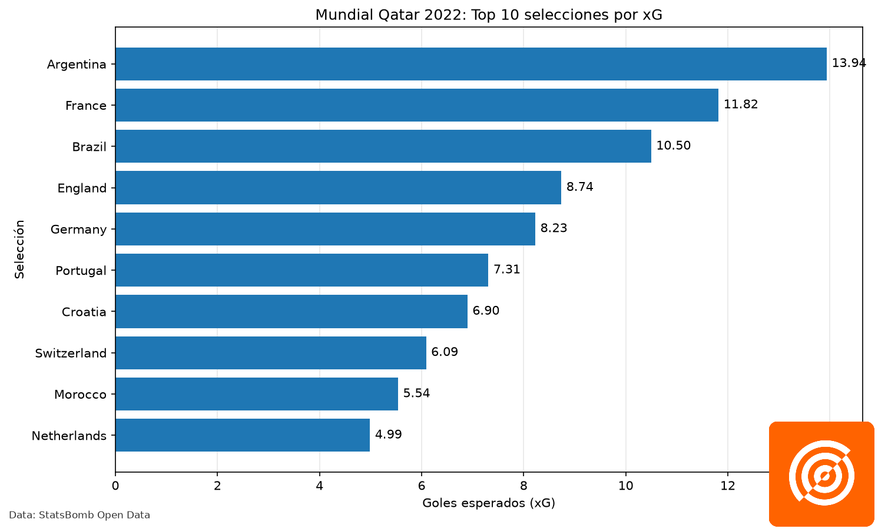
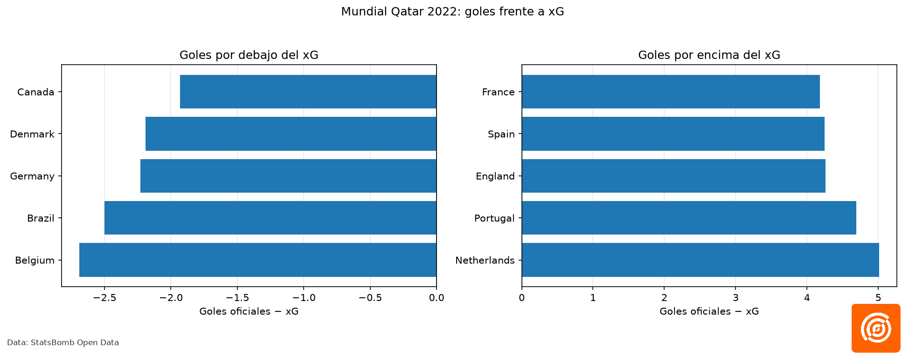

data/: guardará los datos originales y procesados.
notebooks/: contendrá nuestros análisis exploratorios.
src/: guardará el código reutilizable.
reports/: contendrá informes y resultados finales.
README.md: explicará el objetivo, las fuentes y los métodos del proyecto.


# Football Analytics Lab — Project 01
## Offensive Chance Quality at the 2022 FIFA World Cup

### Project Overview

This project analyzes offensive performance at the 2022 FIFA World Cup using event-level football data from StatsBomb Open Data.

The objective is to explore how effectively national teams converted their scoring opportunities into goals by comparing official goals scored with expected goals (xG).

The analysis was conducted using Python, pandas, and Matplotlib.

### Research Questions

- Which national teams generated the highest expected goals (xG)?
- Which teams scored more or fewer goals than their accumulated xG suggested?
- How can event-level data help evaluate offensive performance beyond the final score?

### Data Source

The analysis uses match and event data from the 2022 FIFA World Cup available through [StatsBomb Open Data](https://github.com/statsbomb/open-data).

**Data attribution:** Data provided by StatsBomb. Please refer to the [official repository](https://github.com/statsbomb/open-data) for data access, licensing, attribution requirements, and applicable terms of use.

### Methodology

1. Retrieved the competition and match information for the 2022 FIFA World Cup.
2. Downloaded and processed event-level data for all 64 matches.
3. Identified shot events and extracted their StatsBomb expected goals (`shot_statsbomb_xg`) values.
4. Excluded penalty shootout events from the analysis.
5. Aggregated shots, shot-derived goals, official goals, and xG by national team.
6. Compared official goals scored with accumulated xG.
7. Created visualizations to compare offensive output across teams.

The difference between official goals and xG is calculated as:

`Goal Difference vs. xG = Official Goals Scored − Total xG`

Positive values indicate that a team scored more goals than its accumulated xG. Negative values indicate that it scored fewer goals than its accumulated xG.

### Key Findings

The analysis covered all 64 matches and 32 national teams.

| Metric | Result |
|---|---:|
| Matches analyzed | 64 |
| National teams analyzed | 32 |
| Shot events analyzed | 1,453 |
| Official goals scored | 172 |
| Shot-derived goals | 169 |
| Total accumulated xG | 155.87 |
| Average xG per shot | 0.107 |

**Teams with the highest accumulated xG**

Argentina ranked first with 13.94 xG, followed by France with 11.82 and Brazil with 10.50.

**Goals scored compared with xG**

The Netherlands recorded the largest positive difference among the teams, scoring 10 official goals against 4.99 xG. Belgium recorded the largest negative difference, scoring one goal against 3.69 xG.

These differences describe observed performance during this tournament. They do not, by themselves, establish finishing skill or predict future performance.

### Visualizations

#### Top 10 Teams by Expected Goals



#### Official Goals Compared with Expected Goals



### Repository Structure

```text
football-analytics-lab/
├── data/
│   ├── competitions.json
│   ├── matches_world_cup_2022.json
│   ├── resumen_por_partido.csv
│   └── resumen_ofensivo_mundial_2022.csv
├── figures/
│   ├── top10_xg_mundial_2022.png
│   └── goles_vs_xg_mundial_2022.png
├── src/
│   ├── 03_explorar_eventos.py
│   ├── 04_analizar_remates.py
│   ├── 05_calidad_remates.py
│   ├── 06_visualizar_remates.py
│   ├── 07_analizar_mundial.py
│   ├── 08_grafico_xg.py
│   ├── 09_goles_vs_xg.py
│   ├── 10_validar_goles.py
│   └── 11_revisar_goles.py
└── README.md
```

### Tools and Technologies

- Python
- pandas
- Matplotlib
- JSON and CSV data processing
- Exploratory data analysis
- Football performance analytics
- Expected goals (xG)

### Limitations

- The analysis covers a single international tournament, so the sample is limited.
- Accumulated xG depends on the number and quality of opportunities created.
- A positive or negative difference between goals and xG does not necessarily indicate repeatable finishing ability.
- Official goals include own goals, while the shot-derived goal count is based on shot events recorded as goals.
- The analysis uses StatsBomb's recorded xG values rather than building an independent predictive model.
- Match context, opposition strength, and other tactical factors are not fully modeled.

### Future Improvements

- Compare teams using xG per match and xG per shot.
- Analyze individual player finishing performance.
- Explore shot locations and shot types.
- Investigate performance by match stage and score state.
- Add further tournaments to compare whether observed patterns persist over time.

### Acknowledgements

Thanks to StatsBomb for making football event data available through StatsBomb Open Data.

Data attribution and any required StatsBomb branding should follow the terms and guidance in the official repository.

